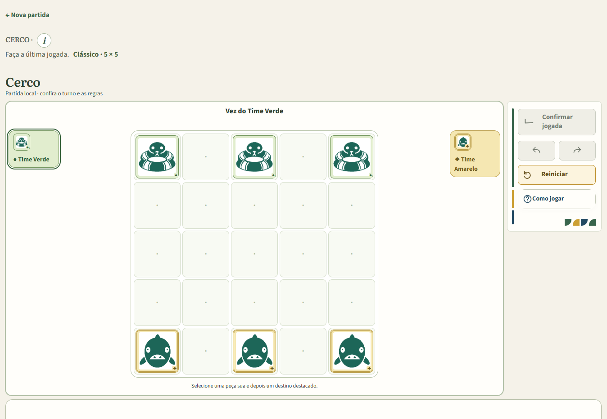
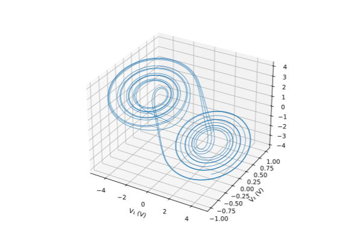
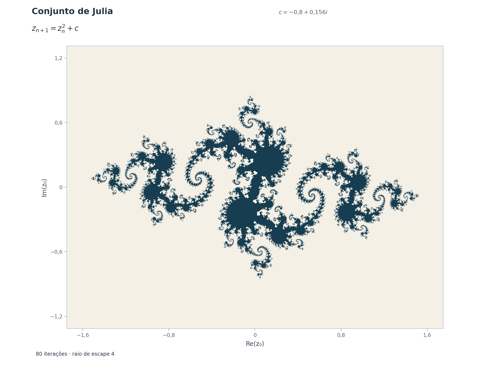
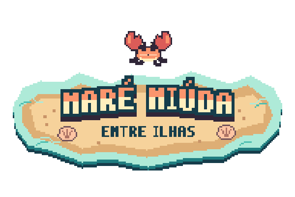
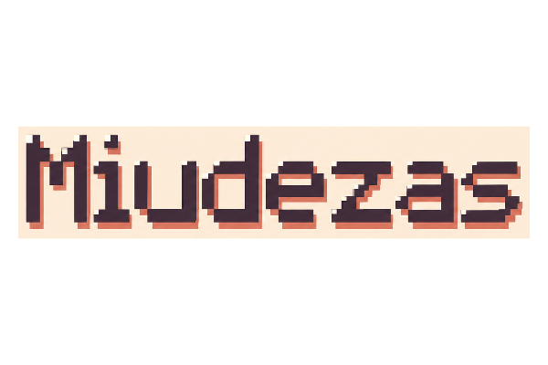

# Luigi Scofano de Araujo

**Computer Engineering at Poli-USP · Applied AI · Data · Software engineering**

I build web products and experiments in applied AI, data, and computing, turning concrete problems into verifiable solutions with readable code, tests, and documentation.

[Português](README.md) · [LinkedIn](https://br.linkedin.com/in/luigi-scofano-de-araujo-233102261/en) · [Email](mailto:luigiscofano.dev@gmail.com) · [All repositories](https://github.com/luigiscofano?tab=repositories)

[About me](#about-me) · [Featured projects](#featured-projects) · [Hardware and systems](#digital-systems-and-computer-architecture) · [Algorithms and Java](#algorithms-and-object-oriented-programming) · [Getting started](#how-to-explore-and-run-the-projects) · [Skills](#skills) · [Experience](#professional-experience)

## About me

I am a **Computer Engineering undergraduate at the University of São Paulo's Polytechnic School**, interested in software development, artificial intelligence, and data science. My background combines academic research, business data analysis, programming projects, and teaching.

I enjoy understanding how tools work: how a model interprets an image, how information can be recovered from a historical document, or how data can answer a business question. I aim to turn that understanding into readable code, documentation, and experiences others can explore.

- **Research:** NLP and OCR for Old Tupi at IME-USP, supervised by Prof. Marcelo Finger; a 3D virtual museum at LASSu-USP.
- **Experience:** dashboards and data analysis at Núclea, technology applied to FX at BTG Pactual, and prototypes supporting commercial work at TRIA Commodities.
- **Currently learning:** Python, machine learning, and generative AI through an IBM learning program.
- **Beyond code:** I teach Brazilian jiu-jitsu and previously helped manage the sport at Poli-USP's athletics association.

### Explore by area

- **AI and data:** [Kaggle-oRF](https://github.com/luigiscofano/Kaggle-oRF), GestureLab, Old Tupi research, and Trilha Viva (optional AI, not yet connected).
- **Web products:** Intuição, Trilha Viva, Pokédex, and the [portfolio](https://luigiscofano.github.io/portfolio/).
- **Engineering and systems:** LabDig, Digital Systems, and MVN Assembly.
- **Learning and experiments:** Numerical Methods, Tetris in C, Algorithms, and Object-Oriented Programming.

Start with **Intuição, Tiny Tide: Between Islands, Trilha Viva, GestureLab, Old Tupi research, Numerical Methods, LabDig, and Pokédex**. Other projects remain in the index below.

### Where to start

| If you want to explore… | Start with |
| --- | --- |
| Browser-based logic, geometry, and strategy games with game AI | [Intuição](https://github.com/luigiscofano/intuicao) |
| Turn-based pixel-art puzzles that use a changing tide | [Tiny Tide: Between Islands](https://github.com/luigiscofano/mare-miuda-entre-ilhas/blob/main/README.en.md) |
| Handcrafted pixel-art minigames you can play in a browser | [Miudezas](https://luigiscofano.github.io/Miudezas/) |
| An oblique random forest with a reproducible synthetic example | [Kaggle-oRF](https://github.com/luigiscofano/Kaggle-oRF) |
| Study materials, source review, and planning with local data | [Trilha Viva](https://github.com/luigiscofano/trilha-viva) |
| A visual application using a webcam and gestures | [GestureLab](https://github.com/luigiscofano/gesturelab) |
| Language research, OCR, and data quality | [Old Tupi research](https://github.com/luigiscofano/ic-pln-tupi-antigo) |
| A web Pokédex with species, forms, evolutions, and game data | [Pokédex](https://github.com/luigiscofano/Pokedex) |
| Mathematical experiments, plots, and notebooks | [Numerical Methods](https://github.com/luigiscofano/usp-metodos-numericos) |
| A C game with a separate rules engine and interface | [Tetris in C](https://github.com/luigiscofano/tetris-c) |
| Circuits, sensors, communication, and FPGA games | [Digital Laboratory I and II](https://github.com/luigiscofano/usp-labdig) |
| Processors, instructions, and low-level execution | [Digital Systems](https://github.com/luigiscofano/usp-pcs3225-sistemas-digitais) and [MVN Assembly](https://github.com/luigiscofano/usp-pcs3616-sistemas-programacao) |
| Algorithms, object-oriented programming, and Java foundations | [MAC0122](https://github.com/luigiscofano/usp-mac0122-algoritmos) and [MAC0321](https://github.com/luigiscofano/usp-mac0321-poo) |

## Featured projects

<table>
<tr>
<td width="33%" valign="top">
<a href="https://github.com/luigiscofano/intuicao"></a>
<a href="https://github.com/luigiscofano/luigiscofano/blob/main/docs/assets/intuicao-cerco.png"></a>

**[Intuição](https://github.com/luigiscofano/intuicao)**

An educational site with 19 logic and strategy games, progressive levels, and a Brazilian visual identity.

HTML · CSS · JavaScript

[Play](https://luigiscofano.github.io/intuicao/) · [Code](https://github.com/luigiscofano/intuicao)

</td>
<td width="33%" valign="top">
<a href="https://github.com/luigiscofano/gesturelab"></a>
<a href="https://github.com/luigiscofano/gesturelab/blob/main/docs/assets/posematch_preview.png"></a>

**[GestureLab](https://github.com/luigiscofano/gesturelab)**

A computer vision application that uses a webcam to recognize gestures, draw in the air, and compare poses.

Python · OpenCV · MediaPipe

[How to test](https://github.com/luigiscofano/gesturelab/blob/main/docs/INSTALACAO.md) · [Code](https://github.com/luigiscofano/gesturelab)

</td>
<td width="33%" valign="top">
<a href="https://github.com/luigiscofano/usp-metodos-numericos"></a>
<a href="https://github.com/luigiscofano/luigiscofano/blob/main/docs/assets/metodos-numericos-julia.png"></a>

**[Numerical Methods](https://github.com/luigiscofano/usp-metodos-numericos)**

Python notebooks with numerical methods, simulations, and fractals for studying accuracy, convergence, and stability.

Python · NumPy · Matplotlib

[Notebooks](https://github.com/luigiscofano/usp-metodos-numericos/blob/main/notebooks/README.md) · [Gallery](https://github.com/luigiscofano/usp-metodos-numericos/blob/main/assets/README.md)

</td>
</tr>
<tr>
<td width="33%" valign="top">
<a href="https://luigiscofano.github.io/portfolio/?lang=en#projeto-mare-miuda"></a>
<a href="https://github.com/luigiscofano/mare-miuda-entre-ilhas/blob/main/docs/arte/galeria/travessias/mundo-01-baixa.png"></a>

**[Tiny Tide: Between Islands](https://luigiscofano.github.io/portfolio/?lang=en#projeto-mare-miuda)**

A turn-based pixel-art tide puzzle with 231 levels across eight worlds and a bilingual offline edition.

HTML · CSS · JavaScript · Canvas 2D

[Case study](https://luigiscofano.github.io/portfolio/?lang=en#projeto-mare-miuda) · [Code](https://github.com/luigiscofano/mare-miuda-entre-ilhas/blob/main/README.en.md)

</td>
<td width="33%" valign="top">
<a href="https://github.com/luigiscofano/Miudezas"></a>
<a href="https://github.com/luigiscofano/Miudezas/blob/main/docs/imagens/telas/selecao-jogos.jpg"></a>

**[Miudezas](https://github.com/luigiscofano/Miudezas)**

Ten neighborhood-inspired pixel-art minigames, with standalone play, a sequence mode, and multiple difficulties.

HTML · CSS · JavaScript · Canvas 2D

[Play](https://luigiscofano.github.io/Miudezas/) · [Code](https://github.com/luigiscofano/Miudezas)

</td>
<td width="33%" valign="top">
<a href="https://github.com/luigiscofano/trilha-viva"></a>
<a href="https://github.com/luigiscofano/portfolio/blob/main/public/images/projects/captures/trilha-viva-painel.jpg"></a>

**[Trilha Viva](https://github.com/luigiscofano/trilha-viva)**

A study platform for organizing text and PDFs, reviewing sources, and tracking progress in the browser.

HTML · CSS · JavaScript · PDF.js

[Open in browser](https://luigiscofano.github.io/trilha-viva/) · [Code](https://github.com/luigiscofano/trilha-viva)

</td>
</tr>
</table>

### Intuição · Logic, geometry, and strategy games

**[Repository](https://github.com/luigiscofano/intuicao)** · HTML · CSS · JavaScript · Game AI  
[Play in your browser · public access](https://luigiscofano.github.io/intuicao/) · [Game manuals](https://github.com/luigiscofano/intuicao/blob/main/docs/jogos/README.md)

An educational platform with **19 browser games organized into Intuição, Logical Reasoning, and Versus**. My work combines game mechanics, level design, hints, interfaces, and documentation, with a Brazilian visual identity built around tiles, mascots, original illustrations, and a green, yellow, and blue palette.

The game AI includes exact search with memoization in DESVIO and minimax with alpha-beta pruning and heuristics in CERCO. The aim is to increase difficulty through the decisions and relationships players discover.

### Tiny Tide: Between Islands · Turn-based tide puzzles

**[Repository and how to play](https://github.com/luigiscofano/mare-miuda-entre-ilhas/blob/main/README.en.md#how-to-play)** · [Case study](https://luigiscofano.github.io/portfolio/?lang=en#projeto-mare-miuda) · HTML · CSS · JavaScript · Canvas 2D · Python

A turn-based pixel-art puzzle with **231 campaign levels across eight worlds**. The tide turns every three valid moves, so players plan their route across tidal flats before the water rises.

The offline edition combines a deterministic game engine, Canvas 2D rendering, and a bilingual Portuguese/English interface. Switching languages does not restart the level.

### Miudezas · Neighborhood minigames

**[Repository](https://github.com/luigiscofano/Miudezas)** · HTML · CSS · JavaScript · Canvas 2D  
[Play in your browser](https://luigiscofano.github.io/Miudezas/) · [Run locally](https://github.com/luigiscofano/Miudezas#executar)

Ten pixel-art minigames with 30 handcrafted levels, standalone matches, and a neighborhood tour. Selected games add endless play or seeded levels checked for solvability. Preferences and personal records stay in the browser.

---

### Trilha Viva · Study materials, sources, and review

**[Repository](https://github.com/luigiscofano/trilha-viva)** · JavaScript · HTML · CSS · Node.js · PDF.js · Tesseract.js  
[Open the application](https://luigiscofano.github.io/trilha-viva/) · [Documentation](https://github.com/luigiscofano/trilha-viva/blob/main/docs/README.md)

A study platform for texts and PDFs, source references, human review, task planning, and history. Includes optional local OCR and backup export/import.

**Current status:** data stays in the browser. The optional AI backend and contracts are available, but no provider is active in the public demo. Supabase accounts and synchronization are not active; n8n, Make, and Zapier have documented integration points, not operational connections. Demonstration content is distinguished from actual AI output, and source checking remains a human responsibility.

### GestureLab · Hands, gestures, air writing, and poses

**[Repository](https://github.com/luigiscofano/gesturelab)** · Python · OpenCV · MediaPipe · NumPy

Computer vision application with four independent modes: hand tracking, gesture recognition, drawing in the air, and pose matching against a local catalog. Uses pretrained MediaPipe models, with drawing export, geometric comparisons, and tests. Air writing currently produces drawings and trajectories.

### Old Tupi research · OCR and linguistic data

**[Repository](https://github.com/luigiscofano/ic-pln-tupi-antigo)** · Python · NLP · OCR · Unicode · Jupyter

Research at IME-USP supervised by **Prof. Dr. Marcelo Finger**, focused on digitizing and structuring Old Tupi dictionary data with Unicode preservation and traceable review. Includes auditing tools and a synthetic demonstration. Academic partner **Calebe Rezende** maintains the related [Tupi–Portuguese Dictionary](https://caleberezende.github.io/tradutorestupi/).

### Pokédex · Gotta catch them all!

**[Repository](https://github.com/luigiscofano/Pokedex)** · HTML · CSS · JavaScript · Node.js · PokéAPI data  
[Explore in your browser · public access](https://pokedex-luigi-explorer.luigiscofano.chatgpt.site) · [User guide](https://github.com/luigiscofano/Pokedex/blob/main/docs/usuario/README.md)

A web application with **1,025 species, 1,351 varieties, and 1,579 cataloged forms**. Features include search and filters, evolutions, types and stats, game-specific descriptions, encounters and moves, Normal/Shiny artwork, and browser-local favorites.

The project combines a responsive interface, versioned data, reproducible imports, tests, and documentation. The original 2023 Java exercise is preserved as an independent module, showing the evolution of my first repository into a browsable application.

### Numerical Methods · Reproducible mathematical experiments

**[Repository](https://github.com/luigiscofano/usp-metodos-numericos)** · Python · NumPy · SciPy · Matplotlib · Jupyter

Notebooks and an educational library covering roots, linear systems, Fourier transforms, interpolation, differential equations, and synthetic GPS. Experiments combine implementations, plots, and tests to study precision, convergence, and stability.

### Kaggle-oRF · Oblique random forest

**[Repository](https://github.com/luigiscofano/Kaggle-oRF)** · Python · NumPy · SciPy · scikit-learn · pandas  
[Run the example](https://github.com/luigiscofano/Kaggle-oRF/blob/main/docs/execucao/README.md)

A Poli-USP artificial intelligence project comparing axis-aligned and oblique forests. The oblique tree computes split directions with PCA/SVD at each node and selects a split by information gain. The reproducible demo uses synthetic data; no competition score is reported.

---

### Tetris in C · Rules, terminal, and replay

**[Repository](https://github.com/luigiscofano/tetris-c)** · C11 · Make · Python verification tools

Terminal game with movement, rotation, line clearing, scoring, and levels. A separate rules engine, deterministic replay, and tests support debugging and reproducibility. This portfolio implementation builds on university coursework.

## Digital systems and computer architecture

### Digital Laboratory I and II · Circuits, sensors, and games

**[Repository](https://github.com/luigiscofano/usp-labdig)** · Verilog · Icarus Verilog · FPGA/Quartus · Processing

Group coursework with circuits, state machines, UART, PWM, and sensors, including the Math Genius and Guardião do Paredão games. Includes source code, reports, and simulations; revised hardware designs still require physical validation.

### PCS3225 · Double-Dabble, calculator, and RISC-V

**[Repository](https://github.com/luigiscofano/usp-pcs3225-sistemas-digitais)** · SystemVerilog · Icarus Verilog · GTKWave

Three Digital Systems II projects: binary-to-BCD conversion, a programmable calculator, and an educational RISC-V subset. Includes control logic, datapaths, testbenches, and waveforms for exploring circuit behavior through simulation.

### PCS3616 · MVN Assembly, stack, and RPN calculator

**[Repository](https://github.com/luigiscofano/usp-pcs3616-sistemas-programacao)** · MVN Assembly · Python

Postfix calculator in MVN Assembly, with a two-pass assembler, educational virtual machine, and stack. Tests and instruction tracing help explore low-level execution, subroutines, and error handling.

## Algorithms and object-oriented programming

### MAC0122 · Algorithms, invariants, and tests

**[Repository](https://github.com/luigiscofano/usp-mac0122-algoritmos)** · Java · C11 · Python verification tools

Studies of gene search, interval union, pair counting, and the Collatz sequence. Implementations include examples, tests, and complexity analysis, emphasizing correctness, invariants, and edge cases.

### MAC0321 · Events, states, CSV, and multisets

**[Repository](https://github.com/luigiscofano/usp-mac0321-poo)** · Java · Object-oriented programming · State pattern

Object-oriented exercises covering event scheduling, state transitions, CSV persistence, and multisets. Demonstrations and tests explore object composition, collections, and file handling; the patient simulation uses fictional rules.

### MAC0321 · Lista 08, Swing, and design patterns

**[Repository](https://github.com/luigiscofano/MAC0321-Lista08)** · Java · Swing · JUnit · Adapter

Coursework **coauthored with Hugo Spadete Arrivabene**, covering a Swing interface, controller tests, collection wrappers, and the Adapter pattern. Exercises focus on separating interface and logic, generics, exceptions, and composition.

## How to explore and run the projects

Each repository explains **its problem, modules, setup, first execution, expected output, and current status**. The [complete project index](docs/PROJETOS.md), in Portuguese, collects entry points and verification links for all public projects. Most detailed project guides are also in Portuguese.

| Family | Typical preparation | First step |
| --- | --- | --- |
| Intuição | Browser for the public demo; Python 3 to serve `dist/` locally | Open the site or follow the repository's local setup guide. |
| Pokédex web | Browser for the public demo; Node.js 20+ with npm for local use | Open the site or run `npm run dev`; Java is an independent optional module. |
| GestureLab | Python 3.12, virtual environment, dependencies, models, camera/graphical environment | Start `hands`, then try the other modes. |
| Old Tupi and Numerical Methods | Python 3.12, dependencies, and a notebook kernel | Run the TSV demo or execute/export notebooks. |
| Tetris | C11 compiler, GNU Make, and ANSI terminal | Run `make demo` for a replay, then play interactively. |
| Algorithms and OOP | JDK 17+; Python 3.12 for the newer verification scripts | Compile/test and run the chosen demonstration. |
| Digital circuits | Icarus Verilog, Python, and optional GTKWave | Simulate a target and inspect its signals. |
| MVN Assembly | Python 3.12 and its standard library | Assemble an RPN expression and inspect its trace. |

**A complete starting example without a webcam, board, or external Python dependencies:** with Git and Python 3.12 installed, run:

```sh
git clone https://github.com/luigiscofano/usp-pcs3616-sistemas-programacao.git
cd usp-pcs3616-sistemas-programacao
python scripts/executar.py "12 3 +" --trace
python -m unittest discover -s tests -v
```

The expression should return `status: 0` and `resultado: 15`; its trace is saved to `build/trace.json`. Use `python3` if that is your system's command. Other projects have their own setup requirements in their READMEs.

## Skills

| Area | Tools and concepts | Portfolio or professional application |
| --- | --- | --- |
| **Software development** | Python, Java, C; JavaScript and TypeScript for web projects | Local applications, CLIs, libraries, domain models, and interfaces. |
| **Computer vision** | OpenCV, MediaPipe, NumPy, coordinates, temporal state | GestureLab: pretrained models, gesture-controlled pen, and pose comparison. |
| **NLP and documents** | OCR, Unicode, lexicographic data, text evaluation, and LLM research | Old Tupi: extraction, source preservation, auditing, and review. |
| **Scientific computing** | NumPy, SciPy, Matplotlib, Jupyter | Numerical implementations, plots, convergence, and reproducible experiments. |
| **Data and BI** | SQL/MySQL, Excel, Power BI, Power Query, DAX | Data preparation, modeling, metrics, and dashboards. |
| **Hardware and architecture** | Verilog, SystemVerilog, FSMs, datapaths, UART, PWM, RISC-V, MVN Assembly | Circuits, communication, simulation, and instruction execution. |
| **Web and computer graphics** | HTML, CSS, JavaScript, Node.js, Three.js, TypeScript, Vite | Pokédex, Intuição, virtual museum, 3D navigation, and interactive browser experiences. |
| **Quality and collaboration** | Git, GitHub, testing, pytest, unittest, JUnit, Ruff, GitHub Actions | Project-specific verification, documentation, and change history. |
| **Foundations** | Algorithms, data structures, OOP, operating systems, networks | Computer Engineering coursework and applied studies. |

**Developing further:** machine learning, generative AI, and data engineering.

## Research and development

Alongside [Old Tupi research](#old-tupi-research--ocr-and-linguistic-data), I work on initiatives connecting technology, education, and interaction.

### Virtual museum · LASSu-USP

I contribute to an **interactive museum about the history of computing**, with a browser-based 3D environment. The project uses **Three.js, TypeScript, and Vite** and involves navigation, object interaction, and educational content.

**Topics:** web development, computer graphics, 3D environments, and learning.

## Professional experience

**Núclea · HR data and reporting**  
I worked with Compensation and Benefits datasets, Power BI dashboards, and analyses using Excel and MySQL. I organized indicators covering headcount, hiring, departures, compensation, and performance, automated data consolidation, and used Git for version control.

**BTG Pactual · Foreign Exchange (FX)**  
I participated in the Summer Job program and contributed to the development of the international transactions web platform, collaborating with the front-end team.

**TRIA Commodities · Commercial work, data, and automation**  
I work in the commercial area and develop prototypes to support prospecting and opportunity tracking. This includes cross-referencing CCEE information with HubSpot, deduplication, and filters for lead analysis.

These experiences strengthen my interest in solutions that connect business needs, data, and technical implementation.

## Education and learning

- **Computer Engineering — University of São Paulo, Polytechnic School:** degree in progress; expected graduation in 2027.
- **CS50 — Harvard / edX:** introductory computer science course completed.
- **Artificial intelligence learning program — IBM / edX:** in progress, covering Python, machine learning, and generative AI.
- **Undergraduate research:** NLP at IME-USP and a virtual museum at LASSu-USP.

<details>
<summary><strong>Teaching, leadership, languages, and other achievements</strong></summary>

### Teaching and leadership

I teach Brazilian jiu-jitsu and self-defense, with activities connected to **Gracie University** and **USP**. Teaching reinforces my commitment to clear explanations, progressive challenges, practice, and feedback.

As jiu-jitsu director at **Poli-USP's athletics association**, I helped organize training, manage resources, coordinate events, and work with students. I also served as a student representative and volunteered as a mathematics and Portuguese teacher at **ACEP**.

### Languages

- **Portuguese:** native.
- **English:** advanced — Cambridge C1 Advanced.
- **Spanish and French:** intermediate.

### Science and mathematics competitions

- **Brazilian National Science Olympiad:** gold in 2020 and 2021.
- **Canguru de Matemática Brasil:** gold in 2021 and silver in 2020.
- **Rio de Janeiro Chemistry Olympiad:** silver in 2020.

</details>

## Organization, authorship, and validation

The portfolio combines applications, educational implementations, research, and coursework archives. Each repository identifies work developed in the current edition, recovered sources, teaching materials, and collaborators' contributions. Group projects, libraries, and models retain their credits and usage terms.

Validation guides explain the scope of each piece of evidence: software tests, circuit simulation, synthetic experiments, and evaluation on real equipment answer different questions. READMEs distinguish available functionality and next steps; history and workflows make progress traceable.

This repository is the profile presentation rendered directly by GitHub. For a local copy, clone `https://github.com/luigiscofano/luigiscofano.git` and open `README.en.md` in a Markdown viewer. The page requires no installation or build.

[Complete project index](docs/PROJETOS.md) · [Documentation standard](docs/PADRAO_README.md) · [Português](README.md)

## Contact

I welcome conversations about projects, research, and opportunities in **software development, artificial intelligence, and data**, especially when there is a concrete problem to investigate and a solution to build.

**[LinkedIn](https://br.linkedin.com/in/luigi-scofano-de-araujo-233102261/en)** · **[luigiscofano.dev@gmail.com](mailto:luigiscofano.dev@gmail.com)**
