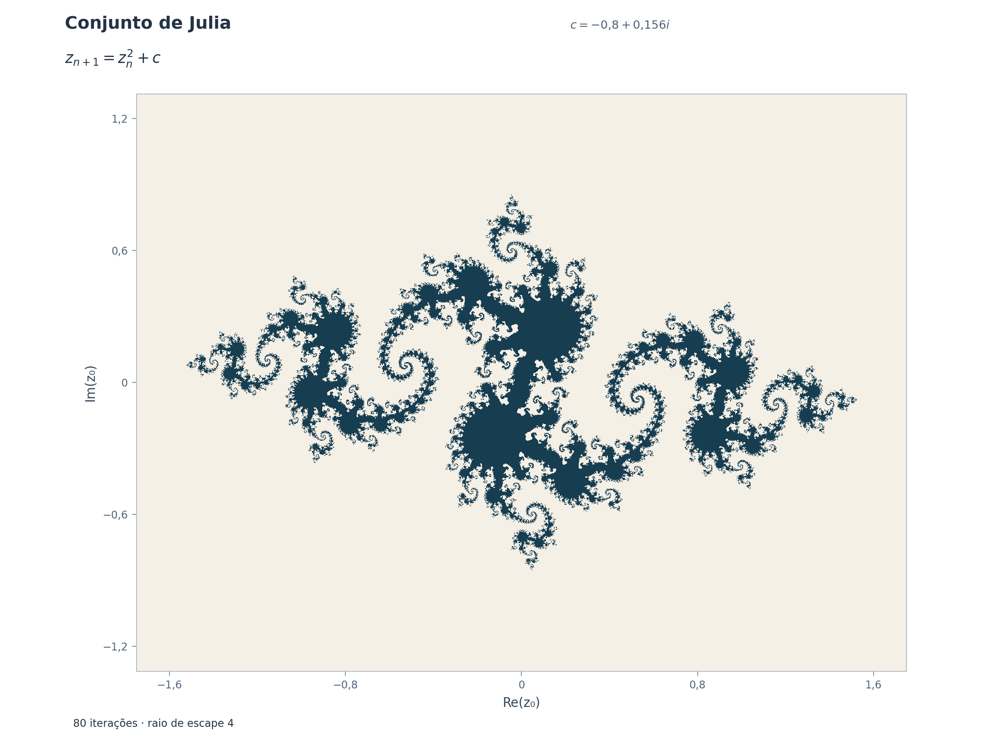

<p></p>

# Luigi Scofano de Araujo

**Engenharia de Computação na Poli-USP · IA aplicada · Dados · Engenharia de software**

Desenvolvo produtos web e experimentos de IA aplicada, dados e computação. Meu foco é transformar problemas concretos em soluções verificáveis, com código claro, testes e documentação.

[Portfólio](https://luigiscofano.github.io/portfolio/) · [LinkedIn](https://br.linkedin.com/in/luigi-scofano-de-araujo-233102261/en) · [E-mail](mailto:luigiscofano.dev@gmail.com) · [English version](README.en.md)

## Conheça meus projetos

<table>
<tr>
<td width="33%" valign="top">
<a href="https://github.com/luigiscofano/intuicao"></a>

**[Intuição](https://github.com/luigiscofano/intuicao)**

Site educativo com 19 jogos de lógica e estratégia, fases progressivas e identidade visual brasileira.

HTML · CSS · JavaScript

[Jogar](https://luigiscofano.github.io/intuicao/) · [Código](https://github.com/luigiscofano/intuicao)

</td>
<td width="33%" valign="top">
<a href="https://github.com/luigiscofano/gesturelab"></a>

**[GestureLab](https://github.com/luigiscofano/gesturelab)**

Aplicação de visão computacional que usa a webcam para reconhecer gestos, desenhar no ar e comparar poses.

Python · OpenCV · MediaPipe

[Como testar](https://github.com/luigiscofano/gesturelab/blob/main/docs/INSTALACAO.md) · [Código](https://github.com/luigiscofano/gesturelab)

</td>
<td width="33%" valign="top">
<a href="https://github.com/luigiscofano/usp-metodos-numericos"></a>

**[Métodos Numéricos](https://github.com/luigiscofano/usp-metodos-numericos)**

Repositório de notebooks Python com métodos numéricos, simulações e fractais para explorar precisão, convergência e estabilidade.

Python · NumPy · Matplotlib

[Notebooks](https://github.com/luigiscofano/usp-metodos-numericos/blob/main/notebooks/README.md) · [Galeria](https://github.com/luigiscofano/usp-metodos-numericos/blob/main/assets/README.md)

</td>
</tr>
</table>

Pesquisa em destaque: [IC · Tupi Antigo — PLN, OCR e dados linguísticos no IME-USP](https://github.com/luigiscofano/ic-pln-tupi-antigo).

<details>
<summary><strong>Trajetória e formação</strong></summary>

- **Poli-USP:** Engenharia de Computação em andamento, com conclusão prevista para 2027. CS50 concluído e formação IBM em IA em andamento.
- **Pesquisa:** PLN e OCR de Tupi Antigo no IME-USP, com o Prof. Marcelo Finger; museu virtual 3D sobre a história da computação no LASSu-USP.
- **Experiência:** dados e indicadores na Núclea; Summer Job em FX no BTG Pactual, colaborando com o front-end; atuação comercial e protótipos de prospecção na TRIA Commodities.
- **Ensino e liderança:** professor de jiu-jítsu e defesa pessoal, ex-diretor da modalidade na Atlética da Poli, representação discente e voluntariado na ACEP.
- **Idiomas:** português nativo, inglês avançado (Cambridge C1), espanhol e francês intermediários.

[Experiências, formação e conquistas em detalhes](docs/TRAJETORIA.md)

</details>

<details>
<summary><strong>Competências</strong></summary>

| Área | Principais conhecimentos |
| --- | --- |
| **Software e web** | Python, Java, C, JavaScript, TypeScript, HTML/CSS, Node.js e Three.js. |
| **IA e dados** | OpenCV, MediaPipe, OCR/PLN, busca de estados; SQL, Power BI, Excel, Power Query e DAX. |
| **Computação científica** | NumPy, SciPy, Matplotlib e Jupyter; análise de precisão, convergência e estabilidade. |
| **Hardware e fundamentos** | Verilog, SystemVerilog, RISC-V, Assembly MVN, algoritmos, estruturas de dados e orientação a objetos. |
| **Qualidade e colaboração** | Git, GitHub, testes automatizados, revisão de código e documentação. |

**Em aprofundamento:** machine learning, IA generativa e engenharia de dados.

[Ferramentas, fundamentos e aplicações nos projetos](docs/COMPETENCIAS.md)

</details>

<details>
<summary><strong>Outros projetos</strong></summary>

- **Produtos web:** [Trilha Viva](https://github.com/luigiscofano/trilha-viva), para organizar estudos e revisões, e [Pokédex](https://github.com/luigiscofano/Pokedex), para explorar espécies, formas e evoluções. No Trilha Viva, IA e sincronização ainda não estão ativas na demonstração.
- **Engenharia e sistemas:** [LabDig](https://github.com/luigiscofano/usp-labdig), [Sistemas Digitais](https://github.com/luigiscofano/usp-pcs3225-sistemas-digitais) e [Assembly MVN](https://github.com/luigiscofano/usp-pcs3616-sistemas-programacao).
- **Algoritmos e programação:** [Tetris em C](https://github.com/luigiscofano/tetris-c), [Algoritmos](https://github.com/luigiscofano/usp-mac0122-algoritmos), [POO](https://github.com/luigiscofano/usp-mac0321-poo) e [Swing e padrões de projeto](https://github.com/luigiscofano/MAC0321-Lista08).

[Índice completo](docs/PROJETOS.md) · [Contexto e como executar](docs/PROJETOS_DETALHADOS.md) · [Todos os repositórios](https://github.com/luigiscofano?tab=repositories)

</details>

<details>
<summary><strong>Conheça os projetos, as experiências e as escolhas técnicas em profundidade</strong></summary>

Aqui reúno o contexto dos projetos, minha participação, as tecnologias utilizadas e os caminhos para testar cada trabalho. As imagens mostram interfaces e resultados reais; os limites de validação permanecem explícitos.

### Produtos, pesquisa e experimentos

### Intuição · Jogos de lógica, geometria e estratégia

**[Abrir repositório](https://github.com/luigiscofano/intuicao)** · HTML · CSS · JavaScript · IA para jogos  
[Jogar no navegador · acesso público](https://luigiscofano.github.io/intuicao/) · [Manuais dos jogos](https://github.com/luigiscofano/intuicao/blob/main/docs/jogos/README.md) · [Quadro de desenvolvimento](https://github.com/users/luigiscofano/projects/1)

Desenvolvo uma plataforma educativa com **19 jogos no navegador, organizados em Intuição, Raciocínio Lógico e Versus**. Os desafios exploram lógica, geometria e estratégia, com regras acessíveis, dificuldade progressiva e identidade visual brasileira com azulejos, mascotes, ilustrações próprias e paleta verde, amarela e azul. Meu trabalho reúne mecânicas, construção de fases, dicas, interfaces e documentação.

O projeto também aplica **inteligência artificial a jogos**: DESVIO utiliza busca exata com memoização nos mapas suportados; CERCO usa minimax com poda alfa-beta e heurísticas, dentro de um orçamento de busca. A proposta é fazer a dificuldade crescer pelas decisões e relações que o jogador descobre, valorizando raciocínio e autonomia.

<p></p>

*Cerco: interface de um dos jogos de estratégia do Intuição.*

---

### Trilha Viva · Materiais, fontes e revisão

**[Abrir repositório](https://github.com/luigiscofano/trilha-viva)** · JavaScript · HTML · CSS · Node.js · PDF.js · Tesseract.js  
[Usar no navegador](https://luigiscofano.github.io/trilha-viva/) · [Documentação](https://github.com/luigiscofano/trilha-viva/blob/main/docs/README.md)

Plataforma de estudos para organizar textos e PDFs, extrair referências, revisar conteúdo, planejar tarefas e acompanhar o histórico. Possui OCR local opcional e exportação/importação de backup.

**Estado atual:** materiais, revisão e progresso ficam no navegador. O backend e os contratos de IA são opcionais; nenhum provedor está ativo na demonstração pública. Contas e sincronização com Supabase ainda não estão ativas; n8n, Make e Zapier têm pontos de integração documentados, não uma integração operacional. O projeto distingue conteúdo demonstrativo de geração real e exige conferência humana das fontes.

---

### GestureLab · Mãos, gestos, escrita no ar e poses

**[Abrir repositório](https://github.com/luigiscofano/gesturelab)** · Python · OpenCV · MediaPipe · NumPy

Visão computacional com webcam para rastrear mãos, reconhecer gestos, desenhar no ar e comparar poses com um catálogo local. Reúne quatro modos independentes, controles interativos e exportação de desenhos e trajetórias.

---

### IC · Tupi Antigo, OCR e dados linguísticos

**[Abrir repositório](https://github.com/luigiscofano/ic-pln-tupi-antigo)** · Python · PLN · OCR · Unicode · Jupyter

Iniciação científica no **IME-USP**, orientada pelo **Prof. Dr. Marcelo Finger**, sobre digitalização e organização de dados de Tupi Antigo. Inclui ferramentas de OCR, normalização Unicode, auditoria e revisão, com demonstração em dados fictícios.

**Parceria acadêmica:** [Dicionário Tupi-Português](https://caleberezende.github.io/tradutorestupi/), projeto de **Calebe Rezende**, com créditos e contexto na documentação da IC.

---

### Pokédex · Temos que pegar!

**[Abrir repositório](https://github.com/luigiscofano/Pokedex)** · HTML · CSS · JavaScript · Node.js · Dados da PokéAPI  
[Explorar no navegador · acesso público](https://pokedex-luigi-explorer.luigiscofano.chatgpt.site) · [Guia de uso](https://github.com/luigiscofano/Pokedex/blob/main/docs/usuario/README.md)

Aplicação web com **1.025 espécies, 1.351 variedades e 1.579 formas catalogadas**. Permite pesquisar e filtrar o catálogo, explorar evoluções, consultar tipos, atributos, descrições, encontros e golpes por jogo, alternar Normal/Shiny e salvar favoritos no navegador.

O projeto reúne interface responsiva, dados versionados, importação reproduzível, testes e documentação. Preserva também o exercício Java original de 2023 em um módulo independente, mostrando a evolução do primeiro repositório para uma aplicação navegável.

<p></p>

*Pokédex: exploração visual do catálogo de Johto.*

---

### Métodos Numéricos · Matemática em experimentos reproduzíveis

**[Abrir repositório](https://github.com/luigiscofano/usp-metodos-numericos)** · Python · NumPy · SciPy · Matplotlib · Jupyter

Notebooks e implementações de raízes, sistemas lineares, Fourier, interpolação, equações diferenciais e GPS sintético. Os experimentos usam gráficos para investigar precisão, convergência e estabilidade dos métodos.

<p></p>

*Conjunto de Julia: resultado numérico, com eixos e parâmetros da experiência.*

---

### Tetris em C · Regras, terminal e replay

**[Abrir repositório](https://github.com/luigiscofano/tetris-c)** · C11 · Make · Python para verificação

Jogo de Tetris no terminal, com movimentação, rotação, pontuação e níveis. O motor é separado da interface e permite reproduzir partidas por replay, com testes das regras e da linha de comando.

---

## Sistemas digitais e arquitetura

### Laboratório Digital I e II · Circuitos, sensores e jogos

**[Abrir repositório](https://github.com/luigiscofano/usp-labdig)** · Verilog · Icarus Verilog · FPGA/Quartus · Processing

Experiências e projetos em grupo da Poli-USP com máquinas de estados, sensores, UART e PWM, incluindo os jogos Math Genius e Guardião do Paredão. Reúne código, relatórios e simulações; as revisões ainda têm validação em placa pendente.

---

### PCS3225 · Double-Dabble, calculadora e RISC-V

**[Abrir repositório](https://github.com/luigiscofano/usp-pcs3225-sistemas-digitais)** · SystemVerilog · Icarus Verilog · GTKWave

Três projetos de Sistemas Digitais II: conversor binário–BCD, calculadora programável e núcleo didático com um subconjunto de RISC-V. Inclui controle, fluxo de dados, testes e formas de onda de simulação.

---

### PCS3616 · Assembly MVN, pilha e calculadora RPN

**[Abrir repositório](https://github.com/luigiscofano/usp-pcs3616-sistemas-programacao)** · Assembly MVN · Python

Calculadora de notação pós-fixa em Assembly MVN, com montador e máquina virtual didáticos. Explora pilha, subrotinas, representação de dados e execução de instruções, com testes e rastreamento passo a passo.

---

## Algoritmos e orientação a objetos

### MAC0122 · Algoritmos, invariantes e testes

**[Abrir repositório](https://github.com/luigiscofano/usp-mac0122-algoritmos)** · Java · C11 · Python para verificação

Estudos de busca de genes, união de intervalos, contagem de pares e sequência de Collatz. Exercitam estruturas de dados, análise de complexidade, invariantes e casos de fronteira, com exemplos e testes.

---

### MAC0321 · Eventos, estados, CSV e multiconjuntos

**[Abrir repositório](https://github.com/luigiscofano/usp-mac0321-poo)** · Java · Orientação a objetos · Padrão State

Exercícios de orientação a objetos com simulação de eventos, transições de estado, persistência CSV e multiconjuntos. O foco está na divisão de responsabilidades, composição de objetos e testes.

---

### MAC0321 · Lista 08, Swing e padrões de projeto

**[Abrir repositório](https://github.com/luigiscofano/MAC0321-Lista08)** · Java · Swing · JUnit · Adapter

Exercícios em **coautoria com Hugo Spadete Arrivabene** sobre interfaces Swing, testes, coleções e padrão Adapter. Exploram separação entre interface e lógica, generics e adaptação por composição.

---

## Como explorar e executar

Cada repositório explica **o problema, os módulos, a instalação, uma primeira execução, os resultados esperados e o estado atual**. O [índice completo](docs/PROJETOS.md) reúne os pontos de entrada de todos os projetos públicos e os links de verificação.

| Família | Preparação típica | Primeiro caminho |
| --- | --- | --- |
| Intuição | Navegador e Python 3 para servir os arquivos de `dist/` por HTTP | Seguir o [guia de execução local](https://github.com/luigiscofano/intuicao#executar-no-computador), escolher um jogo e explorar as regras. |
| Trilha Viva | Navegador para uso local de dados; Node.js 22.13+ para desenvolvimento | Abrir a demonstração ou seguir `npm ci` e `npm run dev` no README; IA e contas não ficam ativas por esse comando. |
| Pokédex web | Navegador para a demonstração pública; Node.js 20+ com npm para execução local | Abrir o site ou executar `npm run dev`; Java é um módulo opcional independente. |
| GestureLab | Python 3.12, ambiente virtual, dependências, modelos e câmera/ambiente gráfico | Iniciar `hands`; depois experimentar os outros modos. |
| Tupi Antigo e Métodos Numéricos | Python 3.12, dependências e kernel para notebooks | Rodar a demonstração TSV ou executar/exportar os roteiros. |
| Tetris | Compilador C11, GNU Make e terminal ANSI | `make demo` para replay; modo interativo para jogar. |
| Algoritmos e POO | JDK 17+; Python 3.12 nos verificadores das edições novas | Compilar/testar e executar a demonstração escolhida. |
| Circuitos digitais | Icarus Verilog, Python e GTKWave opcional | Simular um alvo e acompanhar os sinais. |
| Assembly MVN | Python 3.12 e biblioteca padrão | Montar uma expressão RPN e inspecionar o trace. |

**Exemplo completo para começar sem webcam, placa ou dependências Python externas:** com Git e Python 3.12 instalados, execute no terminal:

```sh
git clone https://github.com/luigiscofano/usp-pcs3616-sistemas-programacao.git
cd usp-pcs3616-sistemas-programacao
python scripts/executar.py "12 3 +" --trace
python -m unittest discover -s tests -v
```

A expressão deve devolver `status: 0` e `resultado: 15`; o rastreamento fica em `build/trace.json`. Se o seu sistema usa `python3`, substitua o nome do comando. Os demais projetos têm requisitos próprios, detalhados em seus READMEs.

---

## Competências em prática

| Área | Ferramentas e conhecimentos | Aplicação no portfólio ou na trajetória |
| --- | --- | --- |
| **Desenvolvimento de software** | Python, Java, C; JavaScript e TypeScript em projetos web | Aplicações locais, CLI, bibliotecas, modelagem de domínio e interfaces. |
| **IA para jogos** | Busca de estados, memoização, minimax, poda alfa-beta e heurísticas | Intuição: bots de DESVIO e CERCO, com decisões calculadas no navegador. |
| **Visão computacional** | OpenCV, MediaPipe, NumPy, coordenadas e estado temporal | GestureLab: modelos pré-treinados, caneta por gestos e comparação de poses. |
| **PLN e documentos** | OCR, Unicode, dados lexicográficos, avaliação textual e estudo de LLMs | IC de Tupi Antigo: extração, preservação da fonte, auditoria e revisão. |
| **Computação científica** | NumPy, SciPy, Matplotlib e Jupyter | Implementação de métodos, gráficos, convergência e experimentos reproduzíveis. |
| **Dados e BI** | SQL/MySQL, Excel, Power BI, Power Query e DAX | Preparação de bases, modelagem, indicadores e dashboards. |
| **Hardware e arquitetura** | Verilog, SystemVerilog, FSM, datapath, UART, PWM, RISC-V e Assembly MVN | Circuitos, comunicação, simuladores e execução de instruções. |
| **Web e computação gráfica** | HTML, CSS, JavaScript, Node.js, Three.js, TypeScript e Vite | Pokédex, Intuição, museu virtual, navegação 3D e experiências interativas no navegador. |
| **Qualidade e colaboração** | Git, GitHub, testes, pytest, unittest, JUnit, Ruff e GitHub Actions | Verificações adequadas a cada projeto, documentação e histórico de mudanças. |
| **Fundamentos** | Algoritmos, estruturas de dados, orientação a objetos, sistemas operacionais e redes | Formação em Engenharia de Computação e estudos aplicados. |

**Em aprofundamento:** machine learning, IA generativa e engenharia de dados.

---

## Pesquisa e desenvolvimento

Além da [pesquisa em Tupi Antigo](docs/PROJETOS_DETALHADOS.md#ic--tupi-antigo-ocr-e-dados-linguísticos), trabalho em iniciativas que aproximam tecnologia, educação e interação.

### Museu virtual · LASSu-USP

Contribuo para um **museu interativo sobre a história da computação**, com ambiente 3D acessível pelo navegador. O trabalho utiliza **Three.js, TypeScript e Vite** e envolve navegação, interação com objetos e apresentação de conteúdo educativo.

**Temas:** desenvolvimento web, computação gráfica, ambientes 3D e aprendizagem.

---

## Trajetória profissional

**Núclea · Dados e indicadores de RH**  
Trabalhei com bases de Remuneração e Benefícios, dashboards em Power BI e análises com Excel e MySQL. Estruturei indicadores de quadro de pessoal, contratações, desligamentos, remuneração e desempenho, além de automatizar a consolidação de informações e utilizar Git no versionamento.

---

**BTG Pactual · Foreign Exchange (FX)**  
Participei do programa Summer Job e contribuí para o desenvolvimento da plataforma web de transações internacionais, colaborando com a equipe de front-end.

---

**TRIA Commodities · Comercial, dados e automação**  
Atuo na área comercial e desenvolvo protótipos para apoiar a prospecção e a organização de oportunidades. O trabalho inclui cruzamento de informações da CCEE com o HubSpot, deduplicação e filtros para apoiar a análise de leads.

Essas experiências reforçam meu interesse por soluções que conectem necessidades de negócio, dados e implementação técnica.

---

## Formação e aprendizado

- **Engenharia de Computação — Escola Politécnica da USP:** graduação em andamento, com conclusão prevista para 2027.
- **CS50 — Harvard / edX:** curso de introdução à computação concluído.
- **Formação em inteligência artificial — IBM / edX:** em andamento, com estudos de Python, machine learning e IA generativa.
- **Iniciação científica:** PLN no IME-USP e museu virtual no LASSu-USP.


[Trajetória completa, ensino, idiomas e conquistas](docs/TRAJETORIA.md) · [Autoria e validação](docs/SOBRE_O_PERFIL.md)

</details>

[Autoria e validação](docs/SOBRE_O_PERFIL.md) · [Padrão de documentação](docs/PADRAO_README.md)
