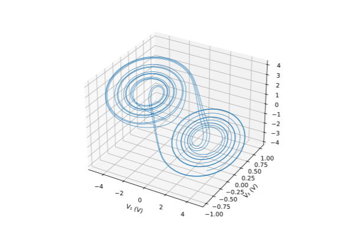

# Luigi Scofano de Araujo

**Engenharia de Computação na Poli-USP · IA aplicada · Dados · Engenharia de software**

Desenvolvo produtos web e experimentos de IA aplicada, dados e computação. Meu foco é transformar problemas concretos em soluções verificáveis, com código claro, testes e documentação.

[Portfólio](https://luigiscofano.github.io/portfolio/) · [LinkedIn](https://br.linkedin.com/in/luigi-scofano-de-araujo-233102261/en) · [E-mail](mailto:luigiscofano.dev@gmail.com) · [English version](README.en.md)

## Conheça meus projetos

<table>
<tr>
<td width="33%" valign="top">

**[Intuição](https://github.com/luigiscofano/intuicao)**

Site educativo com 19 jogos de lógica e estratégia, fases progressivas e identidade visual brasileira.

HTML · CSS · JavaScript

[Jogar](https://luigiscofano.github.io/intuicao/) · [Código](https://github.com/luigiscofano/intuicao)

</td>
<td width="33%" valign="top">

**[GestureLab](https://github.com/luigiscofano/gesturelab)**

Aplicação de visão computacional que usa a webcam para reconhecer gestos, desenhar no ar e comparar poses.

Python · OpenCV · MediaPipe

[Como testar](https://github.com/luigiscofano/gesturelab/blob/main/docs/INSTALACAO.md) · [Código](https://github.com/luigiscofano/gesturelab)

</td>
<td width="33%" valign="top">

**[Métodos Numéricos](https://github.com/luigiscofano/usp-metodos-numericos)**

Repositório de notebooks Python com métodos numéricos, simulações e fractais para explorar precisão, convergência e estabilidade.

Python · NumPy · Matplotlib

[Notebooks](https://github.com/luigiscofano/usp-metodos-numericos/blob/main/notebooks/README.md) · [Galeria](https://github.com/luigiscofano/usp-metodos-numericos/blob/main/assets/README.md)

</td>
</tr>
</table>

Pesquisa em destaque: [IC · Tupi Antigo — PLN, OCR e dados linguísticos no IME-USP](https://github.com/luigiscofano/ic-pln-tupi-antigo).

<strong>Trajetória e formação</strong>

- **Poli-USP:** Engenharia de Computação em andamento, com conclusão prevista para 2027. CS50 concluído e formação IBM em IA em andamento.
- **Pesquisa:** PLN e OCR de Tupi Antigo no IME-USP, com o Prof. Marcelo Finger; museu virtual 3D sobre a história da computação no LASSu-USP.
- **Experiência:** dados e indicadores na Núclea; Summer Job em FX no BTG Pactual, colaborando com o front-end; atuação comercial e protótipos de prospecção na TRIA Commodities.
- **Ensino e liderança:** professor de jiu-jítsu e defesa pessoal, ex-diretor da modalidade na Atlética da Poli, representação discente e voluntariado na ACEP.
- **Idiomas:** português nativo, inglês avançado (Cambridge C1), espanhol e francês intermediários.

[Experiências, formação e conquistas em detalhes](docs/TRAJETORIA.md)

<strong>Competências</strong>

| Área | Principais conhecimentos |
| --- | --- |
| **Software e web** | Python, Java, C, JavaScript, TypeScript, HTML/CSS, Node.js e Three.js. |
| **IA e dados** | OpenCV, MediaPipe, OCR/PLN, busca de estados; SQL, Power BI, Excel, Power Query e DAX. |
| **Computação científica** | NumPy, SciPy, Matplotlib e Jupyter; análise de precisão, convergência e estabilidade. |
| **Hardware e fundamentos** | Verilog, SystemVerilog, RISC-V, Assembly MVN, algoritmos, estruturas de dados e orientação a objetos. |
| **Qualidade e colaboração** | Git, GitHub, testes automatizados, revisão de código e documentação. |

**Em aprofundamento:** machine learning, IA generativa e engenharia de dados.

[Ferramentas, fundamentos e aplicações nos projetos](docs/COMPETENCIAS.md)

<strong>Outros projetos</strong>

- **Produtos web:** [Trilha Viva](https://github.com/luigiscofano/trilha-viva), para organizar estudos e revisões, e [Pokédex](https://github.com/luigiscofano/Pokedex), para explorar espécies, formas e evoluções. No Trilha Viva, IA e sincronização ainda não estão ativas na demonstração.
- **Engenharia e sistemas:** [LabDig](https://github.com/luigiscofano/usp-labdig), [Sistemas Digitais](https://github.com/luigiscofano/usp-pcs3225-sistemas-digitais) e [Assembly MVN](https://github.com/luigiscofano/usp-pcs3616-sistemas-programacao).
- **Algoritmos e programação:** [Tetris em C](https://github.com/luigiscofano/tetris-c), [Algoritmos](https://github.com/luigiscofano/usp-mac0122-algoritmos), [POO](https://github.com/luigiscofano/usp-mac0321-poo) e [Swing e padrões de projeto](https://github.com/luigiscofano/MAC0321-Lista08).

[Índice completo](docs/PROJETOS.md) · [Contexto e como executar](docs/PROJETOS_DETALHADOS.md) · [Todos os repositórios](https://github.com/luigiscofano?tab=repositories)

[Autoria e validação](docs/SOBRE_O_PERFIL.md) · [Padrão de documentação](docs/PADRAO_README.md)
